# 窄屏 CSS 覆盖清单：逐项比对宽屏 / 窄屏视觉效果

> 这份清单回答两件事：**本仓库到底给窄屏写了哪些 CSS 覆盖**，以及**逐条量下来，
> 窄屏是否还保住了宽屏的那份视觉效果**。工效学阈值取自
> [human-factors-screen-design](contributing/skills/human-factors-screen-design/SKILL.md) 与
> [repo-profile.md](contributing/skills/human-factors-screen-design/repo-profile.md)。
>
> 复现：`node .runtime/probe/evidence.mjs "<实例地址>" before|after`（做法见 §5）。
> 读数落在 `artifacts/narrow-ergonomics/<tag>/measurements.json`。

## 0. 口径

| 项 | 值 |
| --- | --- |
| 实例 | DSH `0.2.2-rc.1` + `dsh-pocket@2.12.0`，同一 profile、同一账号 |
| 浏览器 | Playwright Chromium 1.56.1；手机档 `isMobile: true, hasTouch: true` |
| 视口 | 360×640、390×844、430×932、844×390（横屏）、768×1024、1440×900 |
| 主题 | 浅色 + 深色（390×844） |
| 命中区 | 从按钮中心向四方向逐像素外扩，直到 `elementFromPoint` 不再命中它 |
| 宽屏基准 | 1440×900 同一页、同一状态 |

命中区（hit area）与可见图形（visible glyph）是两个数。WCAG 2.5.8 判的是前者，
本清单两个都记。

---

## 1. 覆盖清单总表

「覆盖点」是这份样式改的那个属性。「宽屏」是 1440×900 的实际渲染值，「窄屏」是
390×844 的实际渲染值。判定栏按 ch01/ch02/ch06/ch11 的阈值给。

### 1.1 外壳（`pages-default` / `ui-shared`）

| # | 覆盖点 | 宽屏 | 窄屏 | 判定 |
| --- | --- | --- | --- | --- |
| S1 | 导轨宽度 | 51 px | 51 px | ✓ 不变（产品口径，不参与压缩） |
| S2 | 主内容列宽 | 1389 px | 339 px | ✓ 占满导轨右侧 |
| S3 | `.zw-content` 内边距 | `43px 48px 28px` | `25px 19px` | ✓ ch02：窄屏收紧，不改字号 |
| S4 | 首页主标题 | 24 px | 21 px | ✓ ch11：仍 ≥22.7′（舒适档） |
| S5 | 首页侧栏让出的 51 px | 生效 | **不生效**（抽屉态） | ✓ 见 §2.1 |
| S6 | 账户 / 设置入口位置 | 导轨底部 `[6, 813]` | 抽屉底部 `[59, 798]` | ✓ 见 §2.2 |
| S7 | 鲸鱼命中区（收起/展开侧栏） | 23×17 图形 | 图形不变，**命中区 44×45** | ✓ 见 §2.3 |
| S8 | 导轨项命中区 | 37×37 图形 | 图形不变，**命中区 50×43** | ✓ 见 §2.3 |

### 1.2 文档页（`page-docs`）

| # | 覆盖点 | 宽屏 | 窄屏 | 判定 |
| --- | --- | --- | --- | --- |
| D1 | 左侧目录 | 常驻 229 px 一栏 | **盖在正文上的浮层 258 px** | ✓ 见 §2.4 |
| D2 | 目录默认状态 | 展开 | **收起**（点鲸鱼打开） | ✓ 见 §2.4 |
| D3 | 右页内目录 | 186 px | 隐藏（≤1100） | ✓ 最可选的先让位 |
| D4 | 正文栏宽 | 760 px 版心 | 275 px（吃满） | ✓ |
| D5 | 正文行宽 | ≈56 汉字 | ≈20 汉字 | ✓ ch11：≤40 汉字 |
| D6 | 正文行高 | 1.85 | 1.85 | ✓ ch11：CJK ≥1.6 |
| D7 | 正文内边距 | `30px 40px 44px` | `20px 16px 32px` | ✓ |
| D8 | 分区 tab 命中区 | 26×39 | 30×41 图形，**命中区 44×43** | ✓ 见 §2.5 |
| D9 | 目录条目高度 | 29 px | **39 px** | ✓ ch06：触控行高 |
| D10 | 筛选框高度 | 28 px | **36 px** | ✓ 见 §2.6 |
| D11 | 表格横向溢出 | 0 | 1 处（`md-table-wide` 自滚） | ✓ 二维内容豁免（ch18） |

### 1.3 笔记页（`page-notes`）

| # | 覆盖点 | 宽屏 | 窄屏 | 判定 |
| --- | --- | --- | --- | --- |
| N1 | 三栏排布 | 横排 | **竖排**（≤700） | ✓ 见 §2.7 |
| N2 | 正文 `min-width` | 400 px | 0 | ✓ 地板收回，正文回到 307 |
| N3 | 侧栏基准宽 | 229 px | 100%、限高 45vh | ✓ |
| N4 | 顶栏按钮命中区 | 30×30 | 图形不变，**命中区 33×42** | ✓ 见 §2.8 |
| N5 | 栏头按钮命中区 | 26×26 | 图形不变，**命中区 28×44** | ✓ 见 §2.8 |
| N6 | 正文内边距 | `26px 24px 48px` | `18px 16px 40px` | ✓ |

### 1.4 论文页（`page-paper`）

| # | 覆盖点 | 宽屏 | 窄屏 | 判定 |
| --- | --- | --- | --- | --- |
| P1 | 树栏 + 正文排布 | 横排 | **竖排**（≤700） | ✓ 见 §2.7 |
| P2 | 树栏地板宽 | 190 px | 0 | ✓ |
| P3 | 落地页宽 | 1109 px | 307 px | ✓（改前 84 px，见 §2.7） |
| P4 | 收起态竖窄条 | 28 px 竖条 | **横条**（入口不删） | ✓ |
| P5 | 栏头按钮命中区 | 26×26 | 图形不变，**命中区 28×42** | ✓ 见 §2.8 |
| P6 | 落地页标题 | 21 px | 18 px | ⚠ 18 px @390 仍 ≥24′ ✓，但已到「快速阅读」下限 |
| P7 | 抽屉宽度 | 用户拖动值 | 100%（禁用拖拽） | ✓ 触屏没有拖动余量 |

### 1.5 题库 / 学习 / 规划 / 插件

| # | 覆盖点 | 宽屏 | 窄屏 | 判定 |
| --- | --- | --- | --- | --- |
| Q1 | 题库三档断点 | 1200 / 980 / 760 | 同 | ✓ 未改动，逐页量过无溢出 |
| Q2 | 学习页内边距 | `28px 34px 34px` | `12px 15px 24px` | ✓ |
| Q3 | 学习页课程树 | 常驻 | 折叠为按钮（≤720） | ✓ |
| G1 | 规划页气泡 | 360 px @右下 24 | `calc(100vw - 28px)` @右下 14 | ✓ |
| G2 | 规划页 FAB | 56×56 | 56×56 | ✓ |
| X1 | 插件页版心 | 720 px | 307 px | ✓ |

---

## 2. 逐项：改前 / 改后

每一条都给出**同一场景、同一视口、同一主题**的两张图与读数。改动前的构建是
`before-*`，改动后是 `after-*`。

### 2.1 抽屉态下「侧栏让出 51 px」不该生效

`pages-default` 给宿主 AppFrame 写了三条 `!important`（网格第一列 / SidebarRoot
宽度 / 拖拽手柄）。手机与移动端插件接管侧栏时，侧栏是绝对定位浮层
（`data-sidebar-drawer`），网格第一列不该再被钉成 229。

| | 网格 | 主内容列 |
| --- | --- | --- |
| 改前 | `229px 110px 0` | `[280, 110]` |
| 改后 | `339px 0 0` | `[51, 339]` |

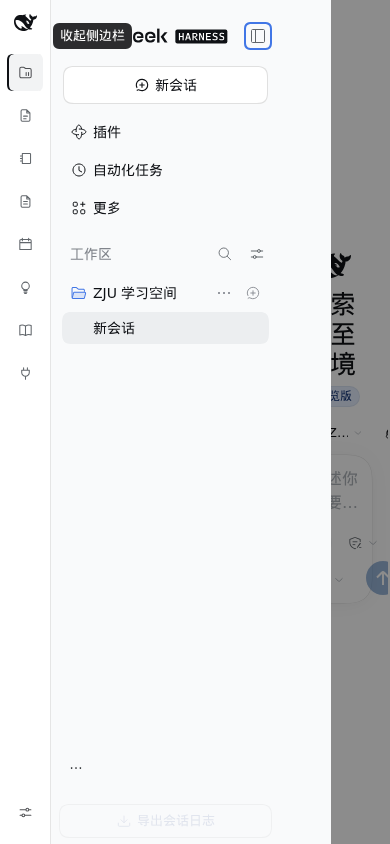
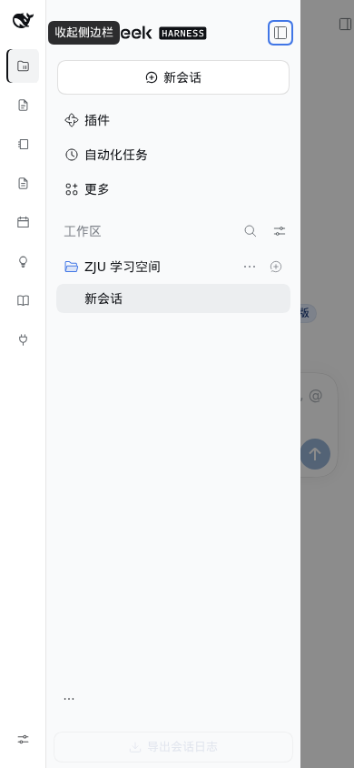

> 这一条在上一轮已经修好（PR #69），本次作为**回归基线**复测，读数一致。
> 本轮 `measurements.json` 里 `390-drawer-open` 的 `rail` 与主内容列也一致（`[51, 339]`）。

### 2.2 账户 / 设置入口在抽屉态被搬到视口外

**这一条是本轮新发现的，也是用户原话「设置项移到导航栏……没法很好落实到窄屏上面」
最具体的那个点。**

搬移规则的前提是「侧栏是一个常驻列」。抽屉态下宿主给侧栏
`transform: translateX(-280px)` 做开合动画 —— 而 `transform` 会让祖先成为
`position: fixed` 的**包含块**，于是 `left: 6px` 变成「相对那条 −280 的浮层再左移」。

实测（390×844，`settings.area`）：

| | 抽屉关着 | 抽屉打开 |
| --- | --- | --- |
| 改前 | `[-223, 757, 37, 37]` —— 被 `left:6px` 缩到 37 宽并推出视口 | `[57, 757, 37, 37]` —— `transform` 归零才碰巧回到视口内 |
| 改后 | `[-221, 798, 264, 40]` —— 宿主原生位置（264 宽整行），在抽屉里，抽屉关着本来就不该看见 | `[59, 798, 264, 40]` |

改后整段搬移挂在 `html:not(:has([data-sidebar-drawer]))` 上：抽屉态不搬，账号入口
留在宿主原生的抽屉底部 —— 拉开抽屉就看到 264 宽的整行「账号菜单」，而不是一粒
37px 的圆头像。**桌面（1440）两个位置都不变：`[6, 813, 37, 37]`。**

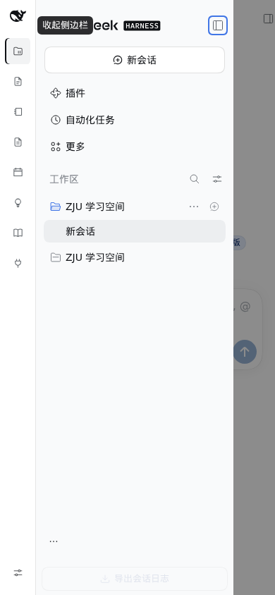
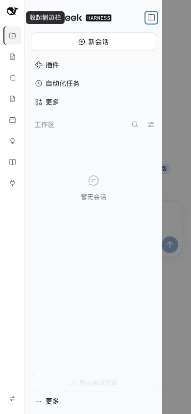

> 改前的形态是「关着时位置算错、打开时靠巧合对」：`left: 6px` 相对那条 −280 的
> 浮层落下，于是关着时 rect 是 `[-223, …]`，打开时才偶然回到视口内。
> 它不是能凑合用，而是每一帧都在依赖那个 `transform` 的当前值。

### 2.3 导轨与鲸鱼的触摸命中区

用户原话：「收起侧边抽屉按钮藏在左上角鲸鱼下」。位置已经在鲸鱼上了，但手机上那枚
鲸鱼的可点区域只有 **23×17**，导航项 37×37 —— 手指点不准。

改法只放大**命中区**（透明 `::after`），图形一个像素不动。

| 目标 | 图形 | 改前命中区 | 改后命中区 | ch06 判 |
| --- | --- | --- | --- | --- |
| 鲸鱼（收起/展开侧栏） | 23×17 | 24×18 | **44×45** | ✓ AAA（≥44） |
| 导轨导航项 | 37×37 | 36×37 | **50×43** | ✓ ≥44 宽 |

只在 `(pointer: coarse)` 生效：鼠标不需要放大，桌面上相邻两个各扩 12 px 会互相盖住。

改前 / 改后**视觉完全一致**（图形没动），差异只在可点范围 —— 所以对比图给的是
命中区探针读数而不是截图：

```text
390×844, (pointer: coarse)   before        after
鲸鱼（收起/展开侧栏）        24×18    →    44×45
导轨导航项                  36×37    →    50×43
笔记顶栏（30px 格）          30×30    →    33×42
笔记栏头（26px 格）          26×26    →    28×44
论文栏头（26px 格）          26×26    →    28×42
1440×900（鼠标）            24×18    →    24×18   ← 桌面不变
```

以上全部来自 `scripts/narrow-audit.mjs` 同一份脚本的 before / after 两次取证。

### 2.4 文档页：手机上目录「永远打不开」

**这是本轮第二个新发现，也是「按钮自相矛盾」那类问题。**

导轨鲸鱼按 `navOpen` 显示「收起文档目录 / 展开文档目录」，点击翻转 `navOpen`。
而窄屏样式表原本是 `@media (max-width: 640px) { .zwd-nav { display: none } }`。
两件事凑在一起就是死的：

```text
默认 navOpen = true  → 鲸鱼写「收起文档目录」，但目录根本没显示
点一下               → navOpen = false → 鲸鱼变「展开文档目录」
再点                 → navOpen = true  → 目录仍然 display: none（永远打不开）
```

实测：改前 `.zwd-nav` 的 rect 恒为 `[0, 0, 0, 0]`、`visible = false`；点完鲸鱼
`navOpen` 翻成 `false`、目录整个不渲染 —— **两个状态都看不见它**。

| | 目录 rect | 可见 | 鲸鱼文案 | 两者一致？ |
| --- | --- | --- | --- | --- |
| 改前 390（初始） | `[0, 0, 0, 0]` | ✗ | 收起文档目录 | ✗ 文案说有、实际没有 |
| 改前 390（点鲸鱼后） | `[0, 0, 0, 0]` | ✗ | 展开文档目录 | ✗ 点了也打不开 |
| 改后 390（初始） | 不渲染 | — | 展开文档目录 | ✓ |
| 改后 390（点鲸鱼后） | `[51, 42, 258, 802]` | ✓ | 收起文档目录 | ✓ |

改法：目录改成**盖在正文上的浮层**（`position: absolute`、`width: min(272px, 84%)`），
并且 `navOpen` 初值跟着视口走（手机收起、桌面展开）。挑完一篇浮层自己让开。

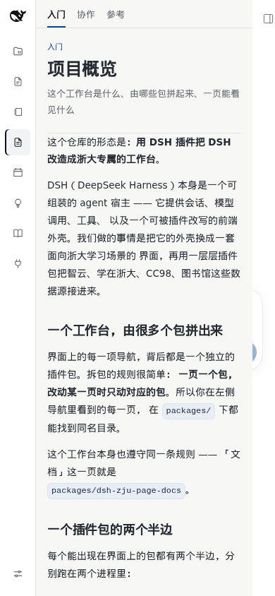
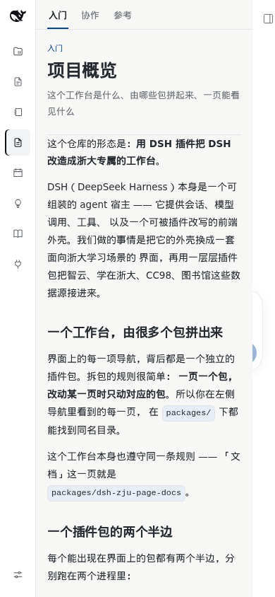


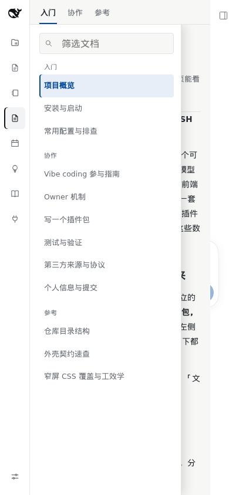

深色主题同一场景：

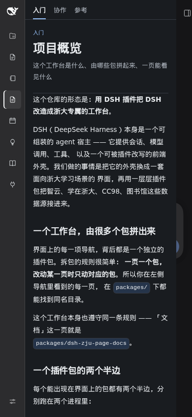
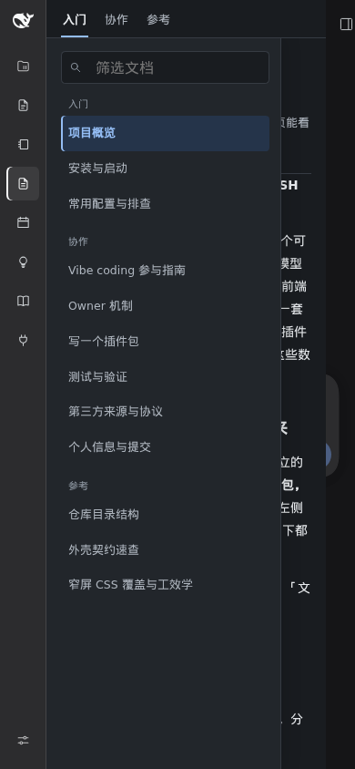

桌面**不变**（回归对照）：1440 下目录仍是常驻 229 px 一栏、默认展开。

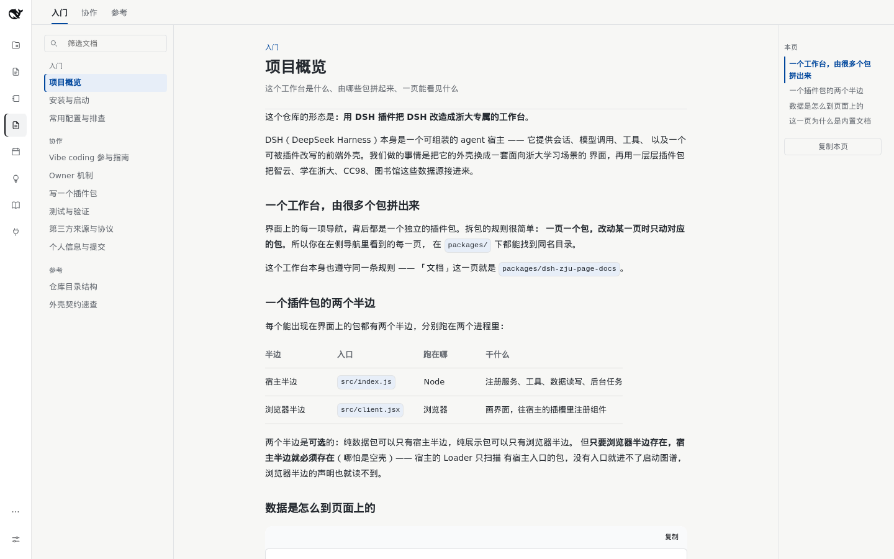
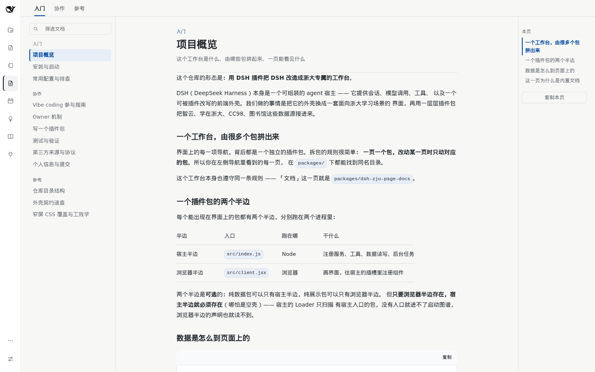

### 2.5 文档页分区 tab 的命中区

「入门 / 协作 / 参考」三个 tab 在手机上量到 30×41 —— 高度够了，宽度由两个字撑出来。
用透明 `::after` 各扩 7 px（三个 tab 间距 16，各扩 7 正好把间隙对半分）。

| | 图形 | 命中区 |
| --- | --- | --- |
| 改前 | 30×41 | 30×41 |
| 改后 | 30×41 | **44×43** |

### 2.6 文档页筛选框

全站输入框有 32 px 的地板（`ui-shared`），但文档页自己写死了 `height: 28px` 把
它压掉了。手机上 28 px 既不好点也不好读（iOS 会在聚焦时自动放大字号）。

| | 高度 |
| --- | --- |
| 改前 | 28 px |
| 改后 | **36 px** |

### 2.7 笔记页 / 论文页：两栏竖着叠

两页都是「两侧面板 + 中间正文」的横排 flex，各自有桌面端的地板宽度：笔记正文
`min-width: 400px`、两页的树栏 `min-width: 190px`。手机屏宽 390 不够两块地板之和。

| 场景 | 改前 | 改后 |
| --- | --- | --- |
| 笔记正文 | `[241, 400]`（右端 641，被裁） | `[51, 307]` |
| 论文落地页 | `[241, 84]`（竖排字） | `[51, 307]` |


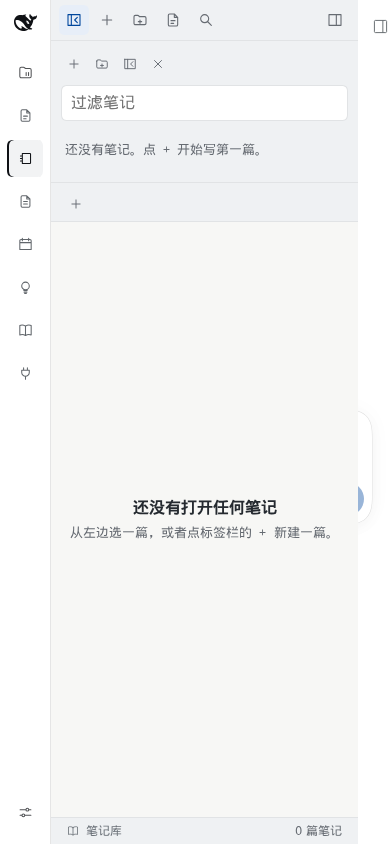

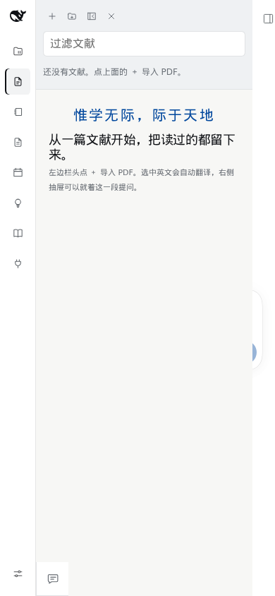


> 同样是上一轮（PR #69）已修，本轮复测确认没有回退。

### 2.8 笔记页 / 论文页：工具栏命中区

两页栏头是一排图标格：笔记顶栏 30 px、栏头 26 px、论文栏头 26 px。桌面上鼠标够准，
手机上相邻两格中心距只有 28–33 px —— 而「全部折叠」隔壁就是删树的入口。

| 目标 | 图形 | 改前命中区 | 改后命中区 |
| --- | --- | --- | --- |
| 笔记顶栏 | 30×30 | 30×30 | **33×42** |
| 笔记栏头 | 26×26 | 26×26 | **28×44** |
| 论文栏头 | 26×26 | 26×26 | **28×42** |

**为什么是 42–44 而不是一律 44**：相邻两格中心距 28。各扩 9 会让两块命中区重叠 1 px
—— 重叠比略小更糟，因为点下去是哪一个取决于层叠顺序，**点错了没有任何提示**。
取 8 得到 42、彼此留 2 px 明确间隔。横向同理受左边距限制。

### 2.9 横屏（844×390）：导轨装不下

横屏时导轨内容 454 px 高、可视 390 px —— 底部两项要滚动才够得着。这是**已知限制**，
见 §4。

---

## 3. 工效学判定汇总

按 [checklist.md](contributing/skills/human-factors-screen-design/checklist.md) 逐条：

| 项 | 结果 | 说明 |
| --- | --- | --- |
| 正文 ≥13 px | ✓ | 全站最小正文 13 px；文档页 13.5 px |
| 长文 ≥14 px | ⚠ | 文档页 13.5 px（差 0.5）；见 §4 |
| 元信息 ≥12 px | ⚠ | 多处 11 px（时间戳、计数、装饰标签），见 §4 |
| 没有 9/10 px 中文 | ✓ | 主包 0 处；`packages/vendor/` 有几处，不在本次范围 |
| 行高 ≥1.6（CJK） | ✓ | 正文 1.85 / 1.9 |
| 长文行宽 ≤40 汉字 | ✓ | 手机约 20 汉字 |
| 正文对比度 4.5:1 | ✓ | `check-hf` 通过（`--zw-muted` 4.60:1 浅 / 5.93:1 深） |
| 触控 ≥9.5 mm | ✓ | 命中区 44 px @96 ppi ≈ 11.6 mm |
| 命中区按点击区域算 | ✓ | 鲸鱼 / 导轨 / 工具栏全部改用 `::after` |
| `:focus-visible` 可见 | ✓ | 未被 `outline:none` 抹掉 |
| 无横向滚动 | ✓ | 六个视口全部 `overflowX = 0` |
| `prefers-reduced-motion` | ✓ | 已有规则，未改动 |

---

## 4. 已知限制与待办

| # | 项 | 现状 | 影响 | 优先级 |
| --- | --- | --- | --- | --- |
| 1 | 文档页正文 13.5 px | 长文口径要 ≥14 px | 手机上读长文略吃力 | P1 |
| 2 | 11 px 元信息 | 多处 | 低于 16′ legibility floor；仅装饰性信息 | P1 |
| 3 | 横屏导轨溢出 | 454 / 390，底部两项要滚 | iOS 横屏时「页面管理」要滚一下才够得着 | P2 |
| 4 | 「复制本页」按钮 | 22×18，在右页内目录里 | ≤1100 时右目录隐藏，手机上**不出现** | — |
| 5 | 论文页落地页标题 18 px | 窄屏降档 | 仍 ≥24′，但已到「快速阅读」下限 | P3 |
| 6 | 学习页 / 题库页的登录态页面 | 未登录时只有一个「登录」按钮 | 登录后的复杂版式**没有**在本轮量过 | P2 |

第 3 条值得单独说：横屏 844×390 时导轨 `scrollHeight = 454 > clientHeight = 390`。
这不是回归（改前改后都是 454），而是**导轨固定 51 px + 十项**在 390 高下装不下。
它有一个自然的修法（横屏时导轨改横向），但那会改变页面壳的布局形态 ——
属于「需要协调多个模块的重设计」，不在本轮授权范围内。

第 6 条同理：本轮所有页面的**未登录态**都量过，登录后学习页的课程树 / 播放器、
题库页的出题表单是更复杂的版式，需要真实的课程数据才能量。

---

## 5. 复现方法

```bash
# 1. 起实例（需要宿主 + 构建产物）；终端会打印带 token 的访问地址
node scripts/profile.mjs start --port <端口>

# 2. 改前 / 改后各跑一次取证（地址用上一步打印的那条）
node .runtime/probe/evidence.mjs "<带 token 的地址>" before
node .runtime/probe/evidence.mjs "<带 token 的地址>" after

# 3. 命中区探针（单独一个脚本：要逐像素外扩）
node .runtime/probe/hit.mjs "<带 token 的地址>"
```

读数直接读 `artifacts/narrow-ergonomics/<tag>/measurements.json`，字段与本页
各条表格一一对应（`whale.box` / `settings.area` / `docs.box` / `targets.small`）。

脚本是**一次性取证**用的，落在 `.runtime/`（已 gitignore），不参与构建。仓库里长期
保留的是读数（各条表格）与截图（`packages/client/pages-default/docs/evidence/narrow-touch/`）。

样式侧回归守卫在 `tests/` 里：

```bash
node --test tests/client/page-docs/docs-phone-nav.test.mjs
node --test tests/client/page-notes/notes-phone-touch-targets.test.mjs
node --test tests/client/pages-default/rail-touch-targets.test.mjs
node --test tests/client/pages-default/settings-entry.test.mjs
```
