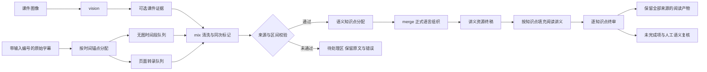

# 以转录时间段为基本单元的讲义链路

解析的基本处理对象是转录时间段，课件页是可选证据。没有课件、最后一页时间窗封顶或某页视觉识别失败，都不能使已有字幕绕过清洗和标记。

vision、页面mix、无图mix共用全局并发限制；一个任务不会另开不受限制的API并发池。时间段是请求窗口，不能拿窗口数量或token切片数当知识点数量。

## 原始字幕与处理状态

每句保留`sourceIndex`、`rawText`、时间和`cleanStatus`，输出必须恰好覆盖输入编号一次。无图段保留`page:null`与`evidenceKind:transcript-only`，不伪造页面依据。视觉失败页可以用转录继续处理，但视觉失败及未核实状态仍保留。

无图mix使用原子块记录：同一条记录携带`index/from/to/role/facets/summary`，不再依赖两份独立清单按序对应。兼容旧缓存时，必须重新验证区间、角色、概述和逐句纠错限额。

`unanchoredUncleanedSentenceCount`只统计无图字幕中尚未通过处理校验的句子；`transcriptOnlySentenceCount`表示没有课件对照的句子数。两个值不能混用。无图处理完成不表示ASR中的专名、日期或公式已经过课件核实。

正文里的「第N句：」和「原文→改写」先剥掉，再量编辑限额。剥完仍超限的句子保留原文，状态为 reverted，并留下审计记录；不再为此另发一次修复调用。同一块里通过限额的句子照常进树。块覆盖和标记都通过时，这一页写入缓存，不因为这一句整页重洗，也不把整个时间段标成失败。不通过扩写短片段来凑齐日期或事实。失败页的未核验句数只计仍未通过的句子，reverted 不计入。

块标记先按严格 JSON 解析；失败后再补非法转义（公式里的 `\sigma` 这类），合法转义不动。每一块都有唯一完整标记时，多出来的标记不推翻这一页。标记条数少于块区间时，不按序号把概述套到后面的块上，只指出缺号，并要求重试改成带 `from`/`to` 的原子记录。

## 资源到阅读层的契约

解析器生成`lectureEligible`，阅读装配、来源导出、终审合回和基准消费同一资格，避免每层重新推断主线。未标记或未清洗内容保存在待处理区，不能混入已组织正文。纯课堂事务排除；同时带知识和事务标签的块不得被机械整块删除，正式组织保留学科内容，原始转录保留事务来源。

每块课件依据独立计算。即使同一个组织请求包含有图和无图来源，无图来源也不会继承其他块的课件。正式正文与clean转录分开保存；`written`表示经过正式组织，不代表事实或语义已经人工验收通过。

大知识点按来源片段限制请求大小，合回仍维持同一知识点；某片段失败时只保留该片段原稿与来源，其他片段的成功缓存可继续复用。

## 终审失败隔离

终审前先检验harness生成的引用和覆盖，输入契约错误不消耗模型调用。每个知识点看到自己的原始转录和课件；概述仅是索引，不能因为概述没提到某事实就判为无来源。

终审回包先在本知识点范围校验；不能跨点修改，不能删除来源、清空正文、题干或解答。失败知识点保留原稿，成功补丁仍可合回。结果使用`complete:false`及逐点`failures`，界面显示部分完成；部分结果不写整体成功缓存。取消仍中止操作，不作为可保存的部分成功。

来源覆盖、清洗完成、正式语言组织、终审处理完成和语义验收是不同证据。任何一个布尔值都不能替代全部质量检查。
